 

Hola! 

 

## Core Stack

 

**Languages**

 

**Frontend**

   

**Backend**

   

**Cloud & Tools**

        

 

## Featured Projects

| Project                               | Description                     | Stack                                           |
| ------------------------------------- | ------------------------------- | ----------------------------------------------- |
| [**BeauWise**](https://beauwise.tech) | Cosmetic AI Ingredient Analysis | React Native · Firebase · Google Cloud Vision · Gemini |

  

## Github Stats

     

  

 

## Learning Resources
> The learning materials that got me into full stack and the resources I still find myself return to, even though I basically just live on Google AI search these days. 

   

 

   — ship it
 

 
 

